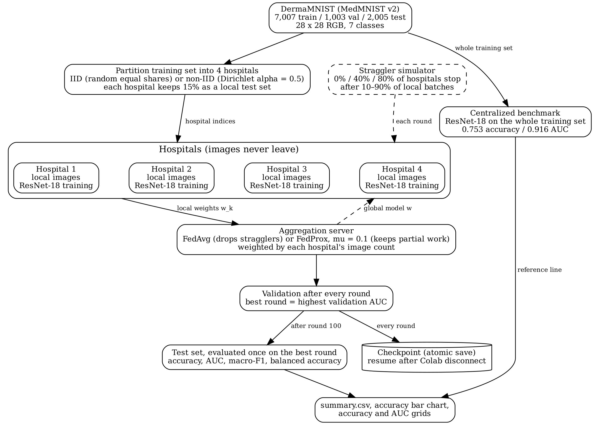

# FL-DermaBench

**Benchmarking FedAvg and FedProx against Centralized Training under IID and Non-IID Settings**

FL-DermaBench measures what is lost, or gained, when a skin-lesion classifier is trained with federated learning instead of on pooled data. Four simulated hospitals train a ResNet-18 on DermaMNIST without sharing images. We compare FedAvg and FedProx with a reproduced centralized MedMNIST v2 benchmark under:

- **similar (IID) or very different (non-IID) hospitals**; and
- **0%, 40% or 80% stragglers**, i.e. hospitals that finish only part of their training in a round.

Authors: Pranav Mahajan, Hardik Chauhan, Sumukh Chaturvedi, Ankush Gaur. School of Computer Science, University of Petroleum and Energy Studies (UPES), Dehradun, India.



## Key results (test set, mean ± std over seeds 42, 43, 44)

**Centralized benchmark (MedMNIST v2 protocol):**

| | Accuracy | AUC |
|---|---|---|
| Ours (3 seeds) | 0.739 ± 0.013 | 0.914 ± 0.003 |
| Published | 0.735 | 0.917 |

**Federated runs:**

| Data | Stragglers | Method | Accuracy | AUC | Macro-F1 | Bal. acc. | Melanoma recall | Hospital gap |
|---|---|---|---|---|---|---|---|---|
| Centralized | – | Benchmark | 0.739 ± 0.013 | 0.914 ± 0.003 | 0.441 ± 0.018 | 0.431 ± 0.015 | 0.378 ± 0.104 | – |
| IID | 0% | FedAvg | 0.674 ± 0.018 | 0.931 ± 0.004 | 0.557 ± 0.017 | 0.654 ± 0.011 | 0.706 ± 0.104 | 0.070 ± 0.029 |
| IID | 0% | FedProx | 0.679 ± 0.033 | 0.935 ± 0.001 | 0.579 ± 0.016 | 0.645 ± 0.011 | 0.725 ± 0.083 | 0.092 ± 0.027 |
| IID | 40% | FedAvg | 0.660 ± 0.019 | 0.923 ± 0.002 | 0.523 ± 0.021 | 0.617 ± 0.007 | 0.726 ± 0.088 | 0.057 ± 0.015 |
| IID | 40% | FedProx | 0.671 ± 0.036 | 0.933 ± 0.003 | 0.568 ± 0.019 | 0.638 ± 0.015 | 0.735 ± 0.134 | 0.092 ± 0.010 |
| IID | 80% | FedAvg | 0.669 ± 0.009 | 0.927 ± 0.003 | 0.537 ± 0.013 | 0.657 ± 0.013 | 0.671 ± 0.022 | 0.073 ± 0.010 |
| IID | 80% | FedProx | 0.648 ± 0.006 | 0.930 ± 0.002 | 0.542 ± 0.005 | 0.651 ± 0.005 | 0.729 ± 0.033 | 0.085 ± 0.008 |
| Non-IID | 0% | FedAvg | 0.748 ± 0.013 | 0.919 ± 0.023 | 0.440 ± 0.057 | 0.425 ± 0.048 | 0.151 ± 0.209 | 0.622 ± 0.082 |
| Non-IID | 0% | FedProx | 0.748 ± 0.017 | 0.928 ± 0.011 | 0.444 ± 0.056 | 0.416 ± 0.046 | 0.117 ± 0.158 | 0.630 ± 0.112 |
| Non-IID | 40% | FedAvg | 0.724 ± 0.012 | 0.903 ± 0.014 | 0.323 ± 0.028 | 0.321 ± 0.032 | 0.132 ± 0.224 | 0.682 ± 0.036 |
| Non-IID | 40% | FedProx | 0.731 ± 0.033 | 0.923 ± 0.013 | 0.387 ± 0.132 | 0.364 ± 0.130 | 0.146 ± 0.231 | 0.633 ± 0.138 |
| Non-IID | 80% | FedAvg | 0.709 ± 0.013 | 0.862 ± 0.024 | 0.254 ± 0.034 | 0.273 ± 0.026 | 0.208 ± 0.216 | 0.657 ± 0.039 |
| Non-IID | 80% | FedProx | 0.735 ± 0.026 | 0.919 ± 0.015 | 0.391 ± 0.107 | 0.379 ± 0.087 | 0.129 ± 0.223 | 0.659 ± 0.102 |

The hospital gap is the best hospital's accuracy minus the worst hospital's accuracy, each measured on that hospital's own held-out images. It is taken at the selected round, the same model that is tested.

**Findings:**

- **FedProx vs FedAvg:** FedProx (mu = 0.1) reaches a higher test AUC than FedAvg in 17 of 18 paired runs (same seed, same setting). See `results/fedprox_vs_fedavg.csv`.
- **Stragglers:** with 80% stragglers on non-IID hospitals, FedAvg oscillates strongly during training, while FedProx stays stable (mean AUC 0.919 vs 0.862).
- **IID hospitals:** with local class balancing, they beat the centralized benchmark in AUC, balanced accuracy and melanoma recall (0.67–0.74 vs 0.38), at a cost in accuracy.
- **Non-IID hospitals:** accuracy matches the benchmark, but melanoma recall falls to 0.12–0.21 and the hospital gap exceeds 0.6.

**Result files:**

- `results/summary_3seeds_pretty.csv` and `results/summary_3seeds.csv`: mean and std over seeds.
- `results/summary_all_seeds_long.csv`: one row per seed and case.
- `results/fedprox_vs_fedavg.csv`: FedProx minus FedAvg for the same seed and setting.
- `results/ablation_seed42.csv`: the training-recipe ablation (seed 42).
- `results/summary_seed42.csv`: the original single-seed output. Its "Centralized" row is the improved recipe (0.795 / 0.948), and its hospital gap is taken at round 100.

## Repository layout

```
FL-DermaBench/
├── notebooks/FL_DermaBench.ipynb   # full pipeline from scratch: benchmark, federated study, 3 seeds, results
├── results/summary_3seeds*.csv      # mean ± std over 3 seeds (plus per-seed and seed-42 files)
├── results/figures/                # 3-seed bar charts and per-round grids, system overview
├── results/figures/seed42/         # original single-seed figures, incl. confusion matrix
├── requirements.txt
├── CITATION.cff
└── LICENSE
```

## How to run

The notebook trains everything from scratch for seeds 42, 43 and 44; no checkpoints are needed.

| Step | Runs | Time on a T4 GPU |
|---|---|---|
| 1. Centralized benchmark | 3 | about 30 min |
| 2. Federated study, IID hospitals | 18 | about 4 h |
| 3. Federated study, non-IID hospitals | 18 | about 4 h |
| 4. Recipe ablation (optional, seed 42) | 4 | about 50 min |
| 5. Results: tables and figures | – | 1 min |

**Google Colab (recommended):**

1. Open `notebooks/FL_DermaBench.ipynb` in Colab: File → Open notebook → GitHub tab → paste this repository's URL.
2. Runtime → Change runtime type → **T4 GPU**.
3. Run the cells from top to bottom. Training cells say so in their first line.
   - The notebook mounts Google Drive and keeps everything in `MyDrive/FL-DermaBench/` (dataset, checkpoints, results, figures).
   - DermaMNIST (about 20 MB) downloads automatically through the `medmnist` package.
   - Steps 2 and 3 are independent, so two Colab accounts sharing the same Drive folder can run them at the same time.

**Local (Mac with Apple GPU, or Linux):**

```bash
pip install -r requirements.txt
jupyter notebook notebooks/FL_DermaBench.ipynb
```

The notebook saves after **every epoch** (centralized) and **every round** (federated). After a disconnect, run all cells again: finished runs are skipped and the interrupted run resumes from its last round.

## Experimental setup

| Setting | Value |
|---|---|
| Dataset | DermaMNIST, 28 x 28, official split 7,007 / 1,003 / 2,005 |
| Model | ResNet-18 with a 3 x 3 first convolution and no max-pooling |
| Centralized benchmark | From scratch, Adam 1e-3, batch 128, 100 epochs, LR x 0.1 at 50 and 75, best epoch by validation AUC |
| Federated | 4 hospitals, 100 rounds x 1 local epoch, same optimizer and schedule |
| Non-IID split | Dirichlet, alpha = 0.5 |
| Stragglers | 0, 2 or 3 of 4 hospitals per round stop after 10–90% of their batches (same schedule for both methods) |
| Recipe | IID: augmentation + ImageNet start + local class balancing; non-IID: augmentation + ImageNet start + label smoothing 0.1 + weight decay 1e-4 |
| Model selection | Best round by validation AUC, evaluated once on the test set |
| Seeds | 42, 43, 44 (initialization, data order, hospital partition, straggler schedule) |
| Hardware | NVIDIA T4 (Google Colab): about 6 s per epoch, 7–8 s per federated round |

## Data

DermaMNIST is part of [MedMNIST v2](https://medmnist.com/) and is derived from HAM10000. It is downloaded automatically; no data is stored in this repository.

## Paper

This repository accompanies the paper *FL-DermaBench: Benchmarking FedAvg and FedProx against Centralized Training under IID and Non-IID Settings* (under review). Every number in the paper's result tables can be checked against the CSV files in `results/`.

## Citation

If you use this code, please cite the paper (full reference added after publication) or use GitHub's **Cite this repository** button, which reads `CITATION.cff`.

## License

MIT. See `LICENSE`.
